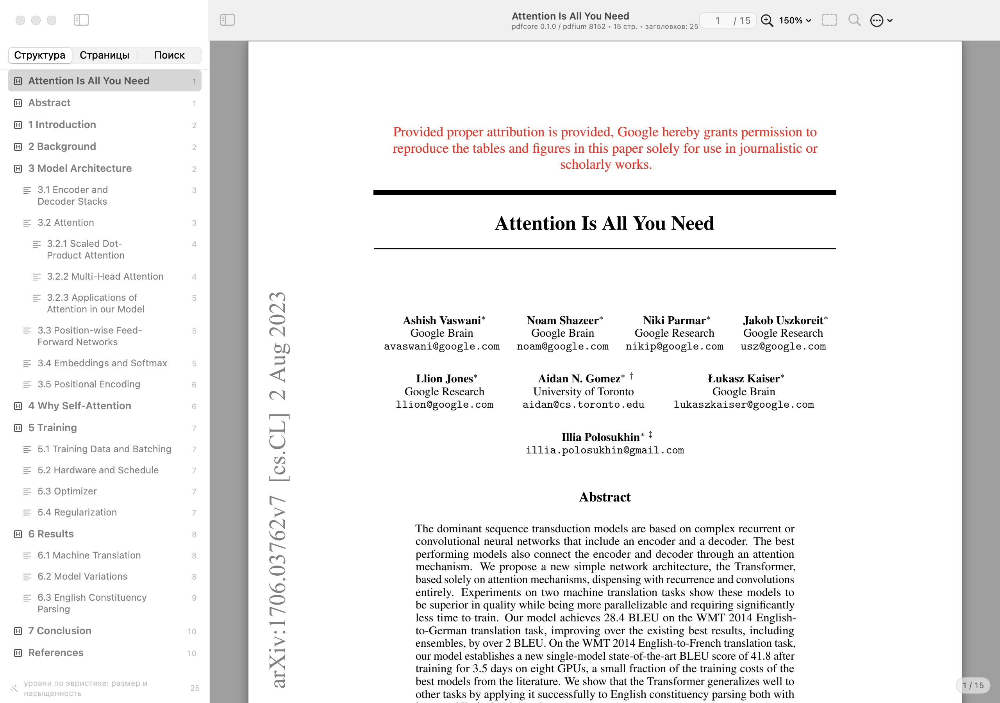
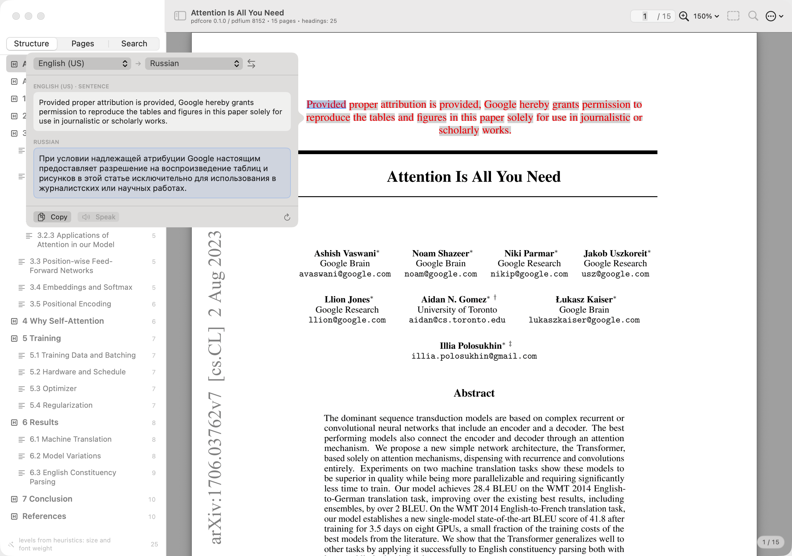
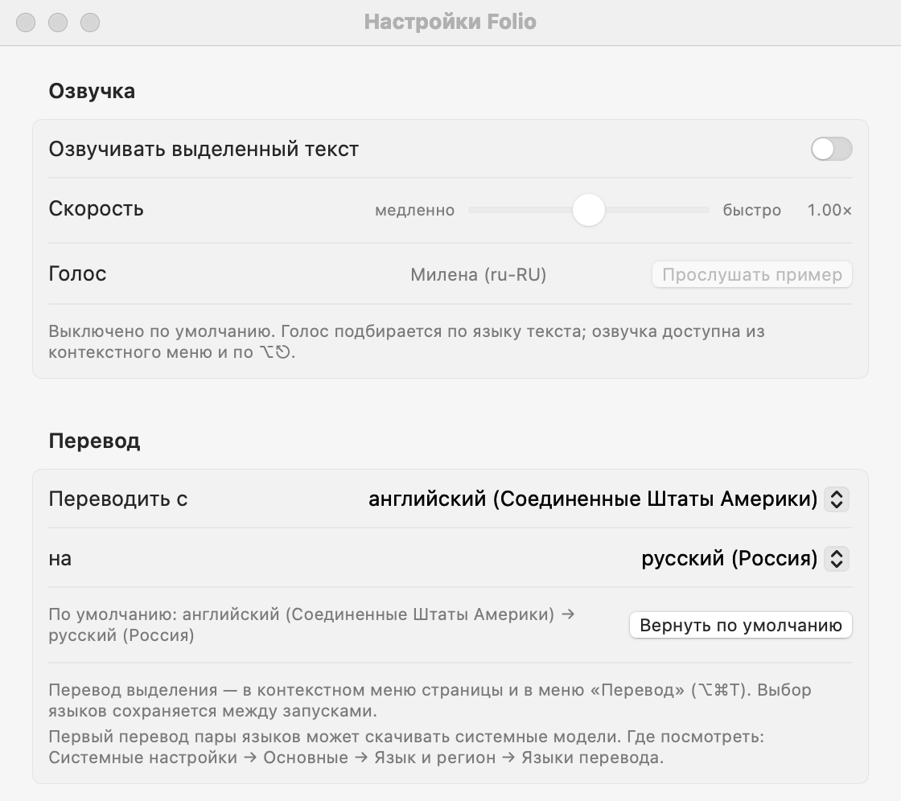

# Folio {{VERSION}}

A native macOS PDF reader with a **Rust/PDFium** rendering core, recovered document structure and
the system thesaurus on a force click — in the spirit of Preview and Books.

<!--
Draft release notes. The release workflow fills the placeholders below (version, checksum, commit,
CI run) and creates a DRAFT release. Add a short "What's new" section for this version and review the
asset before publishing.
-->

## What's new in {{VERSION}}

- _Add the changelog for this version here before publishing._

## Highlights

- **Rust core over PDFium** — per-character boxes, effective font size, bookmarks and tagged-PDF
  structure; headings H1–H6 with `confidence` and source (`heuristic` / `tagged` / `outline`);
  11 element kinds (body, list, caption, table, code, header/footer, formula, quote, reference…).
- **Force click → system thesaurus/dictionary** (`NSView.showDefinition(for:at:)`), also `⌘D` and the
  page context menu; one gesture opens the panel exactly once.
- **Read aloud** — the selection through `AVSpeechSynthesizer`; off by default, toggle/rate/voice in
  Settings, `⌥⎋`.
- **Translation** — the selection through the system Translation framework (`⌥⌘T`); default pair
  English (US) → Russian, a chosen pair is remembered between launches.
- **One window per book** — opening a PDF from Finder or `⌘N` creates an independent window; a cold
  start shows exactly one window, and the last document reopens on the remembered page, scroll and zoom.
- **Open Recent** in the File menu and the toolbar, with an MRU list and “Clear Menu”.
- **Bilingual UI (English and Russian)** that follows the system language; code, comments and
  documentation are English.

| Translation (English UI) | Settings (Russian UI) |
|---|---|
|  |  |

## Install

1. Unzip `Folio.app.zip` and move `Folio.app` to `/Applications`.
2. {{SIGNING_NOTE}}
3. Open PDFs with **Open With → Folio**, by dragging them into the window, or with `⌘O`.

**Requires macOS 14+ and an arm64 Mac** (Apple Silicon). The archive is a thin arm64 build.

## Verification

- CI (macOS 15, Swift 6.0): Rust unit + integration tests, core acceptance (**86/86**) and the app
  build are green for this commit; the same job publishes the bundle as a workflow artifact.
- The release bundle is re-checked here: code signature (`codesign --verify --deep --strict`),
  bundle version and the attached SHA-256.

## Known limitations

{{SIGNING_LIMITATION}}
- no annotations, forms, links or printing; PDF bookmarks are only used as a heading source;
- selection is limited to a single page; scans without a text layer are out of scope (no OCR);
- translation needs macOS 15+ and the system language models; speech depends on system voices;
- the mock demo document (shown when the core is not built) is English-only data.

**SHA-256** `Folio.app.zip`: `{{SHA256}}`

Built from `{{COMMIT}}` — [CI run]({{CI_RUN}}).
