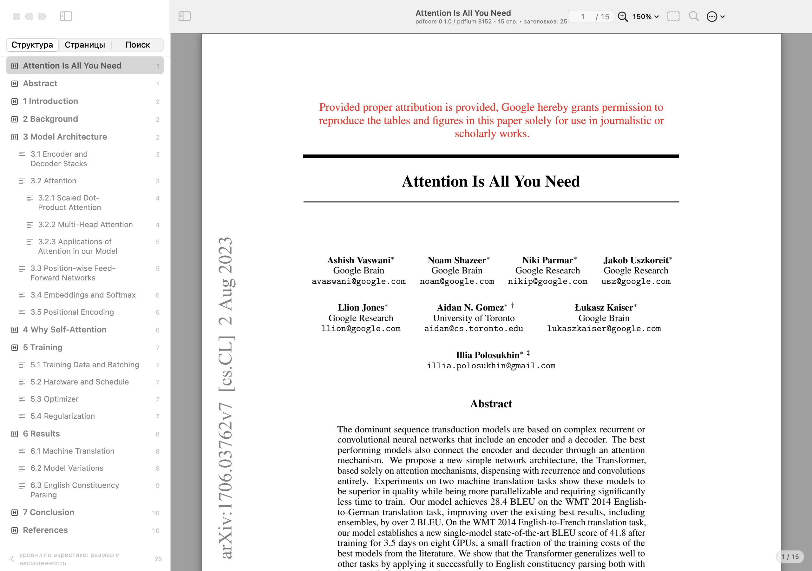
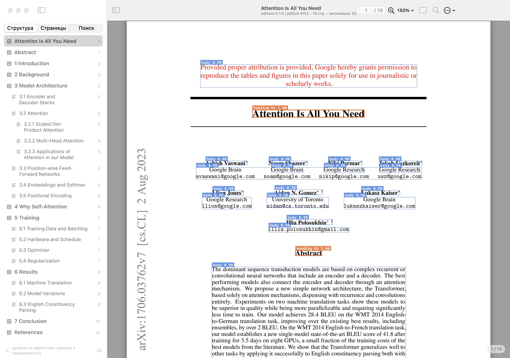
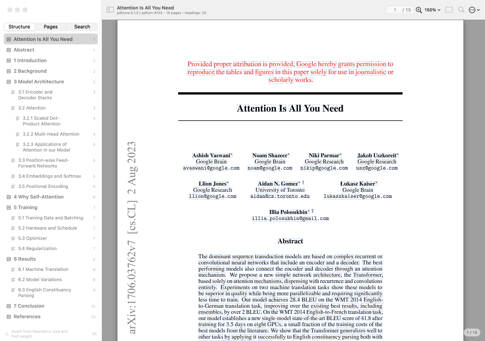
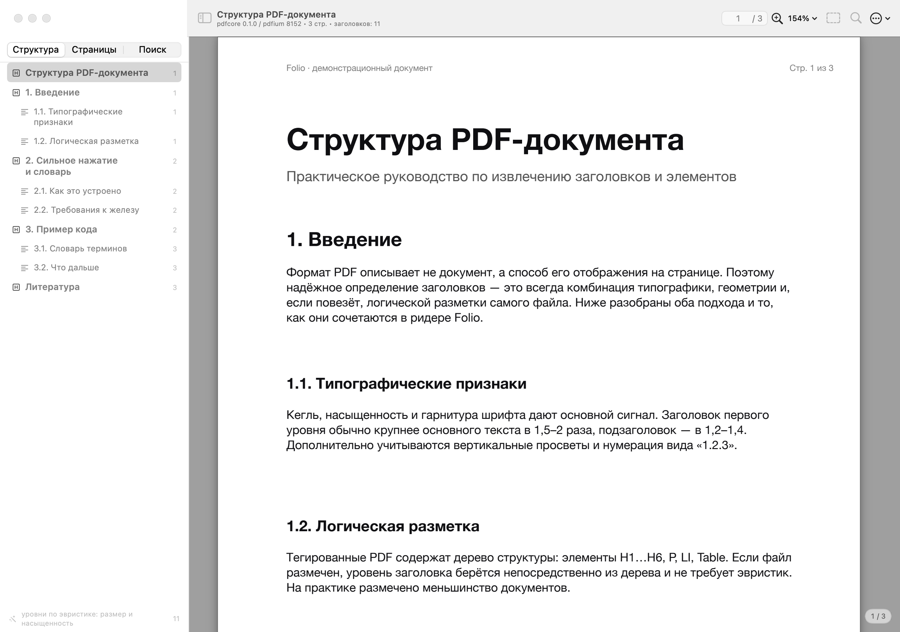
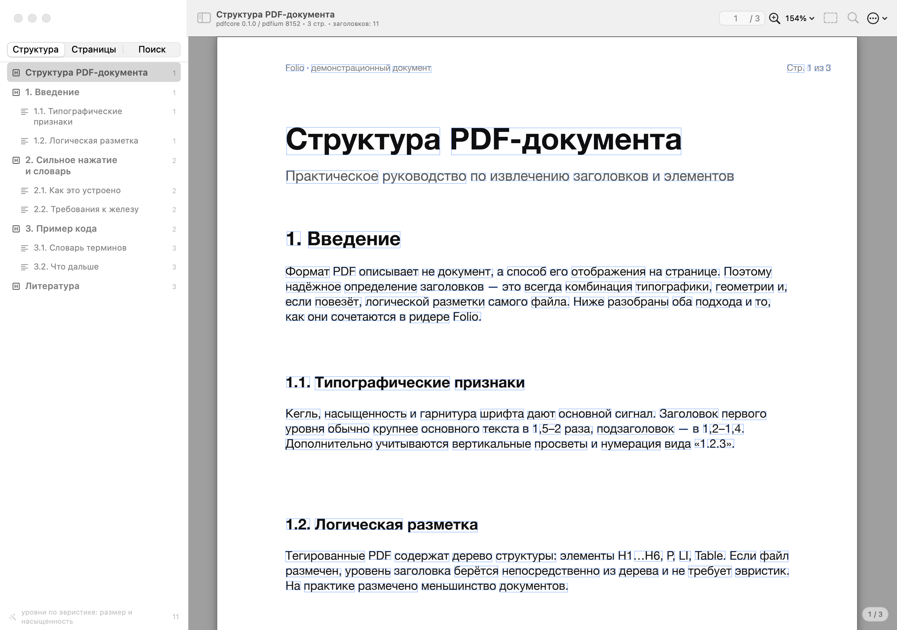
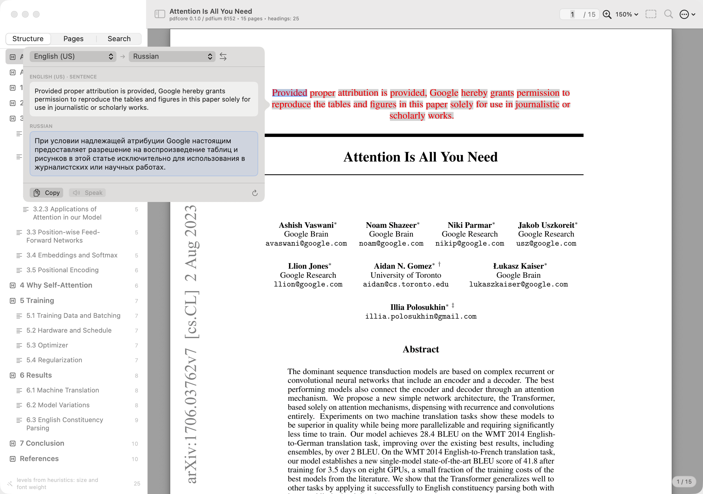
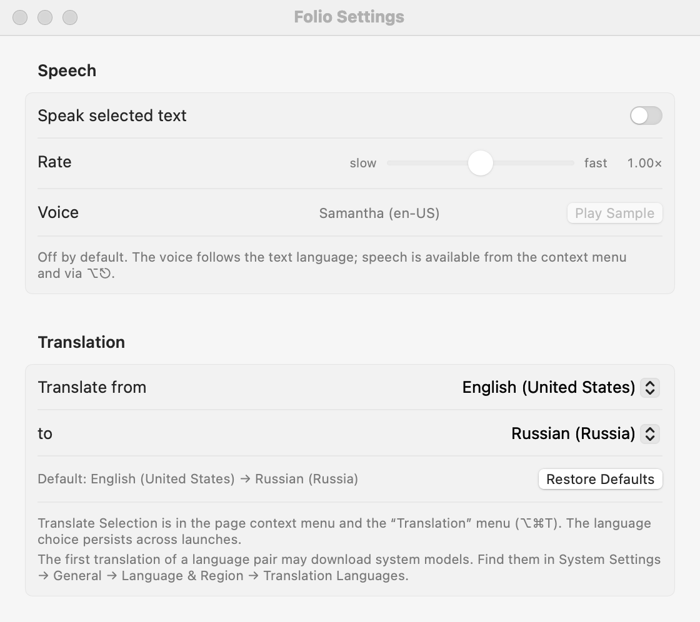

# Folio

A native macOS PDF reader with a **Rust/PDFium** rendering core, recovered document
structure (headings, lists, captions, headers/footers, …) and the system dictionary on a
**force click** — in the spirit of Preview and Books.




The sidebar shows a heading tree recovered from the PDF typography; the page is rendered by
PDFium inside a Rust core; the toolbar carries the document title, page navigation, zoom,
layout debug mode and search.

| Element layout (debug mode) | Per-word boxes (overlay accuracy check) |
|---|---|
|  |  |

Cyrillic document ([`samples/sample-ru.pdf`](samples/sample-ru.pdf)) — same structure recovery
and exact word boxes:

| Structure and page | Per-word boxes |
|---|---|
|  |  |

---

## Download

Prebuilt **Folio** for Apple Silicon: [latest release](https://github.com/ihodorchenko/folio-reader/releases/latest)
→ `Folio.app.zip` (~5 MB, SHA-256 published with the release).

1. Unzip and move `Folio.app` to `/Applications`.
2. Official builds are signed with a Developer ID and notarized from the Xcode project (see
   [Signing and notarization](#signing-and-notarization)). Local builds made with
   `./scripts/build-app.sh` without a certificate are **ad-hoc signed**: on first launch use
   **right-click → Open**, or `xattr -dr com.apple.quarantine /Applications/Folio.app`.
3. Open a PDF with **Open With → Folio**, drag & drop into the window, or `⌘O`.

The archive is a thin **arm64** build and needs **macOS 14+**. To build from source see
[Quick start](#quick-start).

### Automated builds and releases

- Every green build on `main` uploads the signed `Folio.app.zip` plus its SHA-256 as a workflow
  artifact (`Actions → CI → Artifacts`, kept for 14 days).
- Pushing a tag `vX.Y.Z` runs [`.github/workflows/release.yml`](.github/workflows/release.yml): it
  builds the bundle with the version taken from the tag, verifies the signature, the version and the
  bundled localizations, and creates a **draft** GitHub release with `Folio.app.zip` and
  `Folio.app.zip.sha256`. The notes are rendered from
  [`.github/release-notes.md`](.github/release-notes.md) with the version, checksum, commit and CI
  run filled in — adding the "What's new" section and publishing stay manual.

## Signing and notarization

There are two build paths; both produce the same bundle:

- **Xcode project** — the default way to build, archive and distribute. Xcode signs with the team's
  Developer ID (including Xcode-managed certificates) and notarizes from Organizer.
- **`scripts/build-app.sh`** — the command-line/CI path. It builds with SwiftPM + cargo and signs
  ad-hoc by default; pass a Developer ID identity and notary credentials to sign, notarize and staple
  from the terminal (needed for automated releases).

### Signing and notarizing with Xcode (default)

1. Open [`Folio.xcodeproj`](Folio.xcodeproj), select the **Folio** scheme and *Product → Archive*.
2. In Organizer: *Distribute App → Developer ID → Upload*. Xcode re-signs the bundle — including the
   embedded PDFium and Rust dylibs — with the team's Developer ID, submits it to the notary service
   and staples the ticket.
3. Export the notarized app and check it:
   ```bash
   spctl --assess --type execute --verbose=2 Folio.app   # accepted, source=Notarized Developer ID
   codesign -dv --verbose=4 Folio.app | grep Authority    # Developer ID Application: …
   xcrun stapler validate Folio.app
   ```
The project uses the Xcode 27 JSON format (`project.xcproj`) and hard-codes
`DEVELOPMENT_TEAM = 8885WMRK5B`; change it in `Folio.xcodeproj/project.xcproj` if you use another
team. The build phase [`scripts/xcode-embed.sh`](scripts/xcode-embed.sh) builds the Rust core,
renders the icon and embeds the dylibs and `ru.lproj`; everything else is compiled by Xcode from
`app/Sources/Folio`.

### CLI build and notarization (exportable certificate, CI)

The script path needs an **exportable** Developer ID certificate in the keychain (an Xcode-managed
certificate is not visible to `codesign`/`notarytool`).

1. **Apple Developer Program** membership and a **Developer ID Application** certificate in the team.
   Verify it is installed:
   ```bash
   security find-identity -v -p codesigning | grep "Developer ID Application"
   ```
2. **Notary credentials** — an app-specific password (appleid.apple.com → Sign-In and Security) or an
   App Store Connect API key. Create a keychain profile once:
   ```bash
   xcrun notarytool store-credentials folio-notary \
     --apple-id "you@example.com" --team-id "TEAMID" --password "app-specific-password"
   ```
3. Build, sign, notarize and staple:
   ```bash
   FOLIO_SIGN_IDENTITY="Developer ID Application: Your Name (TEAMID)" \
   FOLIO_NOTARIZE=1 FOLIO_NOTARY_PROFILE=folio-notary \
   ./scripts/build-app.sh

   spctl --assess --type execute --verbose=2 dist/Folio.app
   # → dist/Folio.app: accepted, source=Notarized Developer ID
   ```
   The script signs the nested dylibs and the app with the same identity, submits the bundle, staples
   the ticket and only then packs `dist/Folio.app.zip`. Instead of the keychain profile it also
   accepts `FOLIO_NOTARY_APPLE_ID` / `FOLIO_NOTARY_TEAM_ID` / `FOLIO_NOTARY_PASSWORD`, or an API key
   via `FOLIO_NOTARY_KEY_PATH` / `FOLIO_NOTARY_KEY_ID` / `FOLIO_NOTARY_ISSUER`.

### Notarization in CI

Add these secrets under *Settings → Secrets and variables → Actions* and the release workflow signs
and notarizes the bundle automatically:

| secret | contents |
|---|---|
| `MACOS_CERT_P12` | base64 of the exported **Developer ID Application** `.p12` (certificate + key) |
| `MACOS_CERT_PASSWORD` | password of that `.p12` |
| `KEYCHAIN_PASSWORD` | any random string for the temporary CI keychain |
| `NOTARY_APPLE_ID`, `NOTARY_TEAM_ID`, `NOTARY_PASSWORD` | Apple ID, team id, app-specific password — **or** |
| `NOTARY_KEY_P8`, `NOTARY_KEY_ID`, `NOTARY_ISSUER` | base64 of the App Store Connect `.p8` key, its key id and issuer id |

Export the certificate where it is installed: *Keychain Access → right-click the identity → Export…
(.p12)*, then `base64 -i DeveloperID.p12 | pbcopy` and paste into `MACOS_CERT_P12`.

When a tag is pushed, [`.github/workflows/release.yml`](.github/workflows/release.yml) imports the
certificate into a temporary keychain, sets `FOLIO_NOTARIZE=1`, waits for the notary service, staples
the ticket, verifies the signature (`codesign`, `xcrun stapler validate`, `spctl`) and renders the
release notes with the “signed and notarized” wording automatically. Without the certificate the same
workflow produces the ad-hoc build, exactly as before.

> Notarization needs network access and usually takes a few minutes. No entitlements are required
> because the app is not sandboxed; the hardened runtime is enough.

---

## What it does

- **Open PDFs** via `⌘O`, drag & drop, command-line argument or Finder ("Open With → Folio");
  **File → Open Recent** keeps an MRU list of the last documents (the toolbar `…` menu and the
  empty state show the same list), with a "Clear Menu" item.
- **One window per book** — every window owns an independent `ReaderModel`: opening another PDF
  from Finder (or `⌘N`) opens a new window and leaves the books in the existing windows alone.
  A cold start shows exactly one window, even if the previous session had several.
- **Reading position is restored** — the last document opens on the page, scroll offset and zoom
  where it was left; positions are remembered per document, so returning to a book picks up where
  you stopped.
- **Continuous scrolling** with retina rendering (PDFium → BGRA → `CGImage`), zoom via
  `⌘+` / `⌘−` / `⌘1` / `⌘0` (fit width) and pinch.
- **System-style sidebar** with three tabs:
  - **Structure** — heading tree with levels, page number and source
    (`heuristic` / `tagged` / `outline`); clicking an item scrolls to the block;
  - **Pages** — page thumbnails;
  - **Search** — debounced full-document search, highlighted hits, next/previous navigation.
- **Text overlay** — hovered word highlight, drag selection, `⌘C` copy.
- **Selection action bar** — selecting more than one word shows a floating
  **Dictionary / Translate / Copy** bar above the selection. It hides while dragging, while any
  menu (context or menu bar) is open and after copy/lookup/translation, and comes back when the
  menu closes; a single-word selection never shows it.
- **Force click → system dictionary** via `NSView.showDefinition(for:at:)`, plus `⌘D` and a
  context-menu item as a fallback for trackpads without Force Touch.
- **Read aloud** — the selected text (or the word under the right click) through the system speech
  synthesizer. **Off by default**; toggle, speed and voice live in Settings (`⌘,`).
- **Translate** — the selected text through the system Translation framework. The default pair is
  **English (US) → Russian**, and a pair the user picks is remembered between launches.
- **Layout debug mode** — colored boxes per element kind (`heading`, `body`, `list`,
  `caption`, `table`, `code`, `header`, `footer`, `formula`, `quote`, `reference`) with
  `kind/level/confidence` labels, and a per-word box mode that proves the overlay is aligned
  with the actual glyphs.
- **Export structure to JSON** for debugging and downstream pipelines.
- **Unified toolbar**: a single sidebar toggle, the document title on the left and the page
  number, zoom, layout, search and overflow actions pinned to the trailing edge — no duplicated
  sidebar buttons (SwiftUI's automatic toggle is removed through AppKit, see
  [WindowChrome.swift](app/Sources/Folio/UI/WindowChrome.swift)).
- Light/dark appearance, vibrant sidebar, SF Symbols.
- Works even **without a built core** — falls back to a demo document and a banner, which is
  handy while developing the UI.

The UI is **bilingual (English and Russian)** and follows the system language; the code, comments
and documentation are in English. Strings live in code as English text wrapped in `L10n.t(...)` and
are translated in [`app/Resources/ru.lproj/Localizable.strings`](app/Resources/ru.lproj/Localizable.strings);
adding a language means adding another `<lang>.lproj` and listing it in `CFBundleLocalizations`.
The screenshots below show the English UI — Russian variants: [settings](docs/settings-ru.png),
[selection action bar](docs/selection-ru.png).

---

## Architecture

```
┌──────────────────────────── macOS app (Swift 6, SwiftUI + AppKit) ─────────────────────────┐
│  ReaderScene (одно окно = одна книга) → RootView / NavigationSplitView                      │
│                                        ReaderModel (@Observable)      PageCanvasView (NSView)│
│  sidebar: Structure | Pages | Search   caches, async loading, search  CGImage rendering,     │
│                                                                       text overlay, hover,   │
│                                                                       selection, force click │
│  Core/DocumentProviding.swift  ← the only interface that knows about the core               │
│  Core/PdfCoreBridge.swift      ← dlopen("libpdfcore.dylib") + C ABI, JSON → Swift models    │
└──────────────────────────────────────────────┬──────────────────────────────────────────────┘
                                               │ dlopen, C ABI (pdfcore.h)
┌──────────────────────────────────────────────┴──────────────────────────────────────────────┐
│  Rust core pdfcore (crate-type: cdylib + staticlib)                                         │
│   ffi.rs       libpdfium.dylib loading (libloading), FPDF_* declarations                    │
│   text.rs      chars → words → lines → blocks; size = FPDFText_GetFontSize × |matrix|       │
│   classify.rs  heading / body / list / caption / table / code / header / footer / …         │
│   structure.rs document-wide level clustering; PDF outlines and StructTree (H1–H6)          │
│   ffi_api.rs   C ABI: open/close/page_count/page_size/render/layout_json/structure_json/... │
└──────────────────────────────────────────────┬──────────────────────────────────────────────┘
                                               │ FPDF_* (C++)
                                     ┌─────────┴──────────┐
                                     │ PDFium (BSD-3)     │ prebuilt dylib from pdfium-binaries
                                     └────────────────────┘
```

The Rust core is loaded with `dlopen`, so building the Swift app never requires Rust
tooling; and the core itself loads PDFium at runtime, which keeps the native build simple.

Page rendering goes through `RenderStore`: an `NSCache` keyed by document fingerprint, page and
scale, with warm prefetch of the neighbouring pages. Prefetch and the visible page often request
the same key, so a render that is already in flight is shared — every requester subscribes to it
and is notified when the image is ready. Without that subscription a page whose render was started
by prefetch stayed white until some unrelated SwiftUI update happened to retry it.

### Interface contract

[`CONTRACT.md`](CONTRACT.md) is the single source of truth between the layers: C ABI,
JSON schemas for page layout / document structure / search, coordinate system (PDF points,
top-left origin, y down), thread-safety requirements and acceptance criteria. Swift models in
[`app/Sources/Folio/Core/DocumentModel.swift`](app/Sources/Folio/Core/DocumentModel.swift)
mirror the JSON one-to-one.

### Why Rust, and why PDFium

| Option | What it gives | Why it was not used |
|---|---|---|
| **hayro** (pure Rust: `hayro-syntax`, `hayro-interpret`, `hayro-svg`) | parsing + rendering without native dependencies, 1,600+ PDF visual regression suite | text/selection/structure are explicitly out of scope, API still unstable |
| **pdfium-render** (Rust bindings crate) | idiomatic wrappers, MIT/Apache-2.0, text and rendering | we used direct FFI declarations: fewer API-drift surprises, full control over the text matrix and structure trees |
| **mupdf-rs** (MuPDF bindings) | high-quality rendering and text extraction | AGPL / commercial licensing |
| `lopdf`, `pdf` crate | PDF object parsing | no rendering |

The result: **PDFium through hand-written FFI declarations in Rust** with `libloading` —
the most predictable path to reliable structure recovery (per-character boxes, font size,
weight, matrices, `StructTree`).

---

## How structure is recovered

1. **Characters**: `FPDFText_GetUnicode`, char box, effective font size
   (`FPDFText_GetFontSize × |text matrix scale|` — Quartz documents write `Tf=1`, without this
   every size would be "1.0"), weight (`FPDFText_GetFontWeight`), font name and flags.
2. **Words / lines / blocks**: words by spaces and gaps > 0.25 em, hyphenation joined
   (`hyphen-` + `ation`); lines by baseline (sorted by x, otherwise superscript indices split
   words); blocks by columns and style. Reading order is `(page, y, x)`.
3. **Classification**: heading — larger than the median size, bold/font-name hints, numbering
   (`1`, `1.2.3`, `Chapter`, roman numerals), a short single line with vertical spacing;
   list — bullets/numbering; caption — `Figure/Table/Рис./Табл.` prefixes; code — monospace;
   formula — math fonts/symbols; header/footer — text repeated in the top/bottom zone on ≥ 3
   pages; references — small type at the end.
4. **Levels** — clustering of (size, weight) **across the whole document** plus numbering
   depth; PDF bookmarks or a tagged structure tree (H1…H6) are used when present.
5. **Filters**: duplicates, garbage text (letter ratio, interleaved/mixed characters),
   unnumbered candidates after `References`, figure labels, single-symbol footnote blocks.

On the test paper ([`samples/attention.pdf`](samples/attention.pdf), fetched by
`scripts/fetch-samples.sh`) the core finds **25 headings**: L1 — Abstract/1…7/References,
L2 — 3.1–3.5, 5.1–5.4, 6.1–6.3, L3 — 3.2.1–3.2.3, with no headers/footers or garbage.
Performance on M1 Pro (release): full-document structure of 15 pages — 166 ms (cached: 0 ms),
page render at 2× — 8.9 ms, search — 22 ms (97 hits).

---

## Force click → system dictionary

```swift
// PageCanvasView: an NSView with isFlipped = true
override func mouseDown(with event: NSEvent) {
    pressureConfiguration = NSPressureConfiguration(pressureBehavior: .primaryDeepClick)
    mouseDownPoint = pagePoint(from: event)          // point in page coordinates
    ...
}

override func pressureChange(with event: NSEvent) {
    guard event.stage == 2 else { return }           // stage 2 == deep press
    lookUp(at: mouseDownPoint)                       // the word under the press
}

func lookUp(at pagePoint: CGPoint) {
    let word = geometry.wordIndex(at: pagePoint).map { geometry.words[$0] }
    let baseline = CGPoint(x: word.bbox.midX * zoom, y: word.baselineY * zoom)
    showDefinition(for: NSAttributedString(string: word.text), at: baseline)
}
```

`showDefinition(for:at:)` is the public AppKit API that opens the same dictionary panel as
Preview and Books. The three-finger tap / "Look Up" system gesture and the `⌘D` item use the
same code path.

When the right click lands inside a selection, the dictionary opens for the word taken from the
selection (the same thesaurus Preview shows), not for whatever pixel happens to be under the cursor.

One gesture produces one lookup. Force Touch keeps sending `pressureChange` events on stage 2 while
the finger presses, and every extra `showDefinition` reloads the panel (it visibly flickers between
the dictionary list and the entries), so the gesture only fires on the transition into stage 2.
A 0.5 s cooldown merges overlapping sources — force click, `⌘D`, the context menu — and `⌘D`
auto-repeat is ignored.

---

## Speech and translation

Both actions are available from the page context menu, from the `Озвучка` / `Перевод` menus and on
shortcuts: `⌥⎋` reads the selection, `⌥⌘T` translates it.



The panel shows the source text, the translation and the current language pair. Changing the pair
re-translates the same fragment immediately and is stored in `UserDefaults`
(`Folio.translate.source`, `Folio.translate.target`), so the choice survives relaunches; the factory
default is **English (US) → Russian** and can be restored with one button. Translation runs on
device through the system Translation framework (`TranslationSession` handed out by SwiftUI's
`.translationTask`), so the first use of a pair may download language models — macOS 15 or newer is
required, and the menu items are disabled on older systems.



Speech uses `AVSpeechSynthesizer`, with the voice matched to the language of the text
(`NLLanguageRecognizer`, falling back to the system locale). **Speech is disabled by default**: until
it is enabled in Settings the menu items stay visible but disabled and explain where to turn it on,
so a stray shortcut never starts reading in a library.

---

## Quick start

Prefer the prebuilt app? See [Download](#download) above.

Requirements: macOS 14+, Xcode 27.2+ (the project uses the JSON `project.xcproj` format; verified on
macOS 27.2 / Xcode 27.2, arm64) and a Rust toolchain (`rustup`, 1.92+).

### Xcode (default)

```bash
./scripts/download-pdfium.sh   # one-time: prebuilt PDFium (BSD-3), not committed
open Folio.xcodeproj
```

Select the **Folio** scheme and press **⌘R**. The *Build the Rust core and embed dylibs/resources*
phase runs cargo, renders the icon and embeds PDFium + the Rust core automatically. Use
*Product → Archive* for a distribution build (see [Signing and notarization](#signing-and-notarization)).

### Command line / CI

```bash
# 1. PDFium (prebuilt, BSD-3)
./scripts/download-pdfium.sh

# 2. Rust core: cargo build --release, then copy + sign the dylib for the app
./scripts/build-core.sh

# 3. Test fixtures (attention.pdf is not committed)
./scripts/fetch-samples.sh

# 4. Run the app
./scripts/run-app.sh samples/attention.pdf
```

If your Rust toolchain lives in a local directory (as in the original development workspace),
put it in `../.toolchain` next to the repository — the scripts pick it up automatically;
otherwise the system `cargo`/`rustc` from `PATH` is used.

The SwiftPM package builds with `swift build` in `app/`. Note: inside some sandboxed
environments SwiftPM needs `--disable-sandbox`; the provided scripts already pass it.

Test documents:

| File | Purpose |
|---|---|
| `samples/attention.pdf` | 15 pages, LaTeX, untagged: 1–3 level headings, headers/footers, captions (downloaded by `scripts/fetch-samples.sh`) |
| `samples/sample-ru.pdf` | 3 pages, Cyrillic: headings, list, caption, code block, running headers |
| `samples/no-text.pdf` | page without a text layer (0 headings, dictionary reports it gracefully) |

### Build a real `.app`

**Xcode:** *Product → Archive* → Organizer → *Distribute App* (Developer ID) — the resulting app is
signed and notarized by Xcode. For a quick local app: ⌘B then *Product → Show Build Folder*.

**Command line:**

```bash
./scripts/build-app.sh            # release build + icon + ad-hoc signature → dist/Folio.app
open dist/Folio.app
open dist/Folio.app --args samples/attention.pdf
```

Version: the Xcode project stores `MARKETING_VERSION` / `CURRENT_PROJECT_VERSION`; `Info.plist` is a
template whose version keys Xcode overrides. Keep both in sync with:

```bash
./scripts/set-version.sh 1.2.1        # project + Info.plist, keeps the build number
./scripts/check-version.sh            # CI also fails when they diverge
```

The release tag is authoritative in CI: `v1.2.1` builds version `1.2.1` (and checks that the
checked-in version matches). The Xcode project excludes `x86_64`
(`EXCLUDED_ARCHS[sdk=macosx*] = x86_64`) because PDFium and the Rust core are arm64-only.

Bundle layout:

```
dist/Folio.app/Contents/
├── Info.plist            CFBundleIdentifier dev.folio.reader,
│                         CFBundleDocumentTypes → com.adobe.pdf (Open With → Folio)
├── MacOS/Folio           release binary (SwiftUI + AppKit)
├── Frameworks/
│   ├── libpdfcore.dylib  Rust core
│   └── libpdfium.dylib   PDFium
├── Resources/AppIcon.icns
└── PkgInfo
```

- The app looks for the core inside its own bundle first (`Contents/Frameworks`) and only then
  in the development tree, so double-clicking from Finder uses the embedded dylibs.
- `build-app.sh` signs the bundle **ad-hoc** (`codesign --sign -`), which is required on arm64; Xcode
  builds are signed with the team identity. On another Mac Gatekeeper will block an ad-hoc build:
  right-click → Open, or System Settings → Privacy & Security → "Open Anyway". Distribution requires
  a Developer ID certificate and notarization (Xcode Organizer, or `notarytool`/`stapler` for the
  script path).
- `dist/Folio.app.zip` is a clean archive (no extended attributes) suitable for moving to
  another Mac. In a file-provider-synced folder macOS re-adds `com.apple.FinderInfo` to the
  bundle, so `codesign --verify --deep --strict` on that copy may complain — it does not affect
  the signature validity or launching (verified).
- `build-app.sh` registers the bundle in LaunchServices (`lsregister`), so PDFs can be opened
  via "Open With → Folio"; Finder passes the file through
  `application(_:open:)` → `ReaderModel.openFromFinder`.

Icons are generated by [`scripts/make-icon.swift`](scripts/make-icon.swift).

### Keyboard shortcuts

| Shortcut | Action |
|---|---|
| `⌘O` | open a PDF in the current window |
| `⌘N` | new window (its own document) |
| `⌘+` / `⌘−` / `⌘1` / `⌘0` | zoom / actual size / fit width |
| `⌘D` | look up in the dictionary (selection → hover → first word) |
| `⌥⌘T` | translate the selection (system Translation, EN US → RU by default) |
| `⌥⎋` | read the selection aloud (after speech is enabled in Settings) |
| `⌘,` | settings: speech on/off, speed, translation languages |
| `⌘C` / `⇧⌘C` | copy selection / copy selected text (menu item) |
| `⌘F` | search in the document |
| `⌘↑` / `⌘↓` | previous / next page |
| `⇧⌘D` / `⇧⌘W` | element layout / word boxes |
| `⇧⌘E` | export document structure to JSON |
| double-click a PDF in Finder | open in Folio (after bundle registration) |

### Headless snapshot mode

Used for automated acceptance (no Screen Recording permission required):

```bash
./app/.build/debug/Folio --snapshot /tmp/snap samples/attention.pdf
# → root.png, debug.png, debug-words.png, search.png, thumbnails.png, scroll.png,
#   dark.png, selection.png, sidebar-hidden.png, settings.png, translation-panel.png,
#   summary.txt; exit code 0
```

Two optional flags exercise the new features for real instead of rendering placeholder state:
`--snapshot-translate` translates the selected text through the system Translation framework
(requires downloaded language models), `--snapshot-speech` actually speaks the selection through
`AVSpeechSynthesizer`. Without them the run only proves the guards: speech stays silent while the
setting is off, and the panel is filled with demo text.

---

## Testing & verification

- [`scripts/accept-core.py`](scripts/accept-core.py) — an independent core acceptance suite that
  loads the dylib through `ctypes` (the same path the Swift bridge uses) and validates the C ABI,
  JSON schemas, bboxes, reading order, heading levels, header/footer filtering, render
  background/orientation, alpha, search, and error handling on broken files:
  **86/86 checks, both languages**.
- `cargo test` — unit tests for grouping plus integration tests on real PDFs (28 tests).
- The app: snapshots of `attention.pdf` at 100/150/200%, Cyrillic document, `no-text.pdf`,
  document switching (cache invalidation), dictionary path and `⌘C` — verified via logs.
- Selection action bar: `--snapshot` asserts it appears for a 6-word selection, stays hidden for a
  single word, while a drag is in progress, while a menu is tracked (and returns once the menu
  closes), and disappears after copying; screenshots are captured in both languages
  (`docs/selection.png`, `docs/selection-ru.png`).
- Localization: the signed bundle is launched twice with `AppleLanguages` forced to `en` and `ru`;
  the same acceptance run passes in both and the window report confirms localized menu titles
  (`No Recent Documents` vs «Нет недавних документов»), with screenshots captured in both languages
  (`docs/root.png` in English, `docs/settings-ru.png` in Russian).
- Dictionary invocation: `--snapshot` feeds a pressure sequence `[1, 2, 2, 2, 2, 2]` and asserts
  that `showDefinition` runs exactly once, then verifies that two gestures inside the cooldown
  produce one lookup and that a press after the pause opens the panel again (the `⌘D` path is
  checked too, after the cooldown expires).
- Rendering race: `--snapshot` starts a `prefetch` for a page and immediately requests the
  same page, asserting that the image is delivered through the waiter callback. The multi-window
  scenario from the bug report (two books open, one closed, the first book reopened at 205% zoom)
  was re-run on the signed `.app`: the reopened window lands on the remembered page and paints it
  (`image=2509×3247`, `renderErrors: 0`), while the other window keeps its own book.
- Windows and session restore, verified against the signed `.app` through LaunchServices
  (`open -a dist/Folio.app [file.pdf]`, window list checked with `CGWindowListCopyWindowInfo`
  and an in-app report enabled by `defaults write dev.folio.reader Folio.windowReport -bool YES`):
  a cold start with a document yields **one** window, opening two more PDFs yields **three**
  windows holding *different* documents, and a plain relaunch restores the last book on the page
  it was left (`--goto-page` equivalent via `Folio.debugGotoPage` + graceful quit). SwiftUI's
  own window for an open event and macOS window restoration are cleaned up by
  [WindowHygiene.swift](app/Sources/Folio/App/WindowHygiene.swift).
- Recent documents, verified in the headless run and against the signed `.app`: MRU ordering,
  de-duplication, the 12-document limit and "Clear Menu" are asserted on a throwaway
  `UserDefaults` suite; in the app the menu is rebuilt live after every open (the submenu items
  were dumped from `NSApp.mainMenu`: `attention.pdf | sample-ru.pdf | Очистить меню`), and a menu
  item was "clicked" programmatically to confirm it replaces the open document and updates the
  MRU order. SwiftUI builds `Commands` submenus once, so the list is rendered by an
  `NSMenuDelegate` ([RecentDocumentsMenu.swift](app/Sources/Folio/App/RecentDocumentsMenu.swift)).
- Settings and translation contract, verified in the same headless run: speech is **off** by
  default, the language pair defaults to **EN (US) → RU**, a user-chosen pair and speed survive a
  simulated relaunch (throwaway `UserDefaults` suite — the developer's real preferences are not
  touched), `speak()` refuses to run while the toggle is off, and the page context menu is dumped
  and checked for the dictionary, translate, speak and settings items (with different titles for a
  selection and for a bare word).
- The `.app` bundle: launching from `dist/Folio.app` (including with cwd `/`, like Finder) uses
  the embedded dylibs from `Contents/Frameworks`; opening a PDF through LaunchServices loads
  the document (verified via the persisted `lastDocumentPath`); `codesign --verify --deep
  --strict` passes on the archive staging copy and on the unzipped bundle.

> Note: the system dictionary panel cannot be screenshotted in a headless environment (no
> Screen Recording permission), so automation verifies the `showDefinition(for:at:)` call and
> the baseline point via logs. The actual stage-2 pressure events can only be felt on a real
> Force Touch trackpad.

### `pc-cli` (core debugging tool)

```bash
cd core
./target/release/pc-cli info      ../samples/attention.pdf
./target/release/pc-cli structure ../samples/sample-ru.pdf
./target/release/pc-cli blocks    ../samples/attention.pdf --page 0
./target/release/pc-cli text      ../samples/attention.pdf --page 0 --pretty
./target/release/pc-cli render    ../samples/attention.pdf --page 0 --scale 2 --out /tmp/page.ppm
./target/release/pc-cli search    ../samples/attention.pdf attention
./target/release/pc-cli bench     ../samples/attention.pdf
```

---

## Project layout

```
.
├── CONTRACT.md                  core ↔ app contract (C ABI, JSON, acceptance criteria)
├── LICENSE
├── core/                        Rust core (PDFium)
│   ├── src/{ffi,text,classify,structure,json_types,api,ffi_api,lib}.rs
│   ├── src/bin/pc-cli.rs        CLI: info/text/structure/blocks/render/search/bench
│   ├── include/pdfcore.h        C ABI header
│   ├── tests/integration.rs
│   └── vendor/pdfium/           libpdfium.dylib + headers (downloaded, not committed)
├── Folio.xcodeproj/             Xcode project (JSON project.xcproj): default build/archive path,
│                                Distribution App → Developer ID; builds Rust/PDFium in a phase
├── app/                         SwiftUI + AppKit sources (shared by Xcode and SwiftPM)
│   ├── Package.swift
│   ├── Bundle/Info.plist
│   ├── Resources/               UI localizations (ru.lproj; English is the source language)
│   └── Sources/Folio/
│       ├── App/         FolioApp (menus, ⌘C/⌘D monitors), ReaderScene, WindowRouter,
│       │                WindowHygiene, RecentDocumentsMenu, SnapshotRunner, WindowReport,
│       │                AppDebugHooks, L10n
│       ├── Model/       ReaderModel (one per window), ReadingPositionStore,
│       │                RecentDocumentsStore, SettingsStore, SpeechService,
│       │                TranslationController, ReaderFocus
│       ├── UI/          RootView, page canvas, sidebars, SettingsView,
│       │                TranslationPanel, TranslationTaskHost
│       └── Core/        PdfCoreBridge (dlopen + C ABI), JSON models
├── scripts/                     download-pdfium, build-core, run-app, build-app, xcode-embed,
│                                make-icon, fetch-samples, accept-core, make-sample-ru
├── samples/                     sample-ru.pdf, no-text.pdf (+ attention.pdf fetched)
├── .github/                     CI (build, tests, artifact) and release workflow + notes template
├── docs/                        screenshots, icon and reference notes
└── dist/                        built Folio.app (+ zip), not committed
```

---

## Limitations & roadmap

Current limitations:

- no annotations, forms, links, printing; PDF bookmarks are only used as a level source;
- selection is limited to a single page; no cross-page selection;
- complex scripts (RTL, vertical text) and scans without a text layer are out of scope (no OCR);
- the app is built as a SwiftPM executable and a minimal `.app` bundle: no Developer ID
  signature or notarization, no App Sandbox;
- render cache is bounded by size; very heavy pages are not optimized;
- stage-2 force click requires a Force Touch trackpad; `⌘D` is the fallback;
- translation needs macOS 15+ and the language models installed by the system: the first use of a
  pair can take minutes while the models download (progress is shown by the framework);
- speech uses the system voices; it is off by default and only reads the selection/word, not a
  whole page;
- zooming beyond fit-width shows a horizontal scrollbar (no auto-centering);
- the UI is in Russian (localization is not implemented yet).

Natural next steps on top of the current architecture:

- links and annotations (`FPDFLink_*`, `FPDFAnnot_*`);
- proper document-based app (`NSDocument` / `DocumentGroup`) instead of the custom
  per-window model (recent documents and reading position are already implemented);
- incremental rendering and neighbor-page preloading;
- tagged PDF → semantic tree (currently only H1–H6 + outlines);
- English UI + localization via String Catalogs;
- translating whole blocks/pages in one batch (`translations(from:)`) and caching the results;
- Developer ID signing, notarization and a DMG.

---

## License & acknowledgements

- Code: **MIT** (see [`LICENSE`](LICENSE)).
- **PDFium** — BSD-3-Clause, Copyright The PDFium Authors (Chromium project). Prebuilt macOS
  binaries come from [bblanchon/pdfium-binaries](https://github.com/bblanchon/pdfium-binaries);
  the license texts are shipped inside the downloaded archive.
- Rust dependencies: `libloading` (ISC), `serde` / `serde_json` (MIT/Apache-2.0),
  `once_cell` (MIT/Apache-2.0).
- The test paper "Attention Is All You Need" (Vaswani et al., arXiv:1706.03762) is downloaded
  locally by `scripts/fetch-samples.sh` and is not part of this repository.
